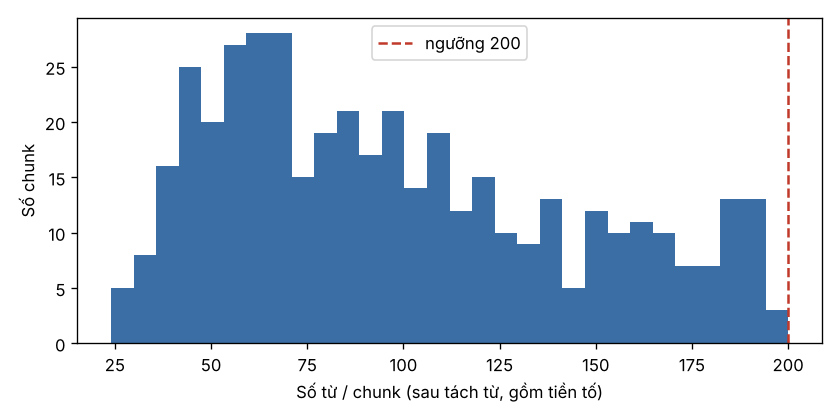

# Báo cáo chất lượng kho văn bản hộ tịch

Sinh tự động bởi `python -m src.data.corpus_report`. Đừng sửa tay, chạy lại script khi dữ liệu đổi.

**Tổng quan:** 10 văn bản, 256 Điều, 1305 đơn vị (Điều/Khoản/Điểm/Phụ lục) ở bản gốc;
sau áp `amendments.yaml` còn 1317 đơn vị; kho cuối có **433 chunk** từ 9 văn bản.

## 1. Số Điều

| doc_id | so_dieu_tach | so_dieu_ban_goc | khop | danh_so_lien_tuc |
|---|---|---|---|---|
| 60.2014.QH13 | 77 | 77 | True | True |
| 123.2015.ND-CP | 45 | 45 | True | True |
| 87.2020.ND-CP | 25 | 25 | True | True |
| 04.2020.TT-BTP | 39 | 39 | True | True |
| 104.2022.ND-CP | 15 | 15 | True | True |
| 09.2022.TT-BTP | 4 | 4 | True | True |
| 04.2024.TT-BTP | 4 | 4 | True | True |
| 07.2025.ND-CP | 5 | 5 | True | True |
| 120.2025.ND-CP | 24 | 24 | True | True |
| 18.2026.ND-CP | 18 | 18 | True | True |

## 2. Phân bổ Điều theo Chương (văn bản gốc, sau sửa đổi)

| doc_id | Ch.I | Ch.II | Ch.III | Ch.IV | Ch.V | Ch.VI | Ch.VII |
|---|---|---|---|---|---|---|---|
| 60.2014.QH13 | 12 | 22 | 18 | 4 | 8 | 10 | 3 |
| 123.2015.ND-CP | 8 | 5 | 18 | 14 | 3 | 0 | 0 |
| 04.2020.TT-BTP | 5 | 21 | 11 | 2 | 0 | 0 | 0 |
| 87.2020.ND-CP | 5 | 6 | 4 | 8 | 2 | 0 | 0 |

## 3. Độ dài mỗi Điều (số từ sau tách từ underthesea)

| doc_id | min | median | max |
|---|---|---|---|
| 04.2020.TT-BTP | 53 | 213 | 920 |
| 04.2024.TT-BTP | 59 | 200 | 957 |
| 07.2025.ND-CP | 108 | 433 | 1527 |
| 09.2022.TT-BTP | 29 | 91 | 145 |
| 104.2022.ND-CP | 51 | 155 | 444 |
| 120.2025.ND-CP | 46 | 98 | 574 |
| 123.2015.ND-CP | 25 | 164 | 569 |
| 18.2026.ND-CP | 25 | 403 | 3316 |
| 60.2014.QH13 | 12 | 95 | 458 |
| 87.2020.ND-CP | 60 | 189 | 806 |

Ở 4 văn bản gốc có 65 Điều dài hơn ngưỡng 200 từ nên bị tách theo Khoản ở bước chunk.
Dài nhất: 04.2020.TT-BTP Điều 29 (920), 87.2020.ND-CP Điều 12 (806), 04.2020.TT-BTP Điều 31 (643), 123.2015.ND-CP Điều 3 (569), 87.2020.ND-CP Điều 3 (541).

## 4. Rỗng và trùng nội dung

- Điều rỗng (không có chữ nào sau khi bỏ khoản bị bãi bỏ): 0
- Đơn vị trùng nội dung (dài hơn 30 ký tự, còn hiệu lực): 4 → ví dụ: 'a) Thực hiện đăng ký hộ tịch theo quy định của Luật này;'
- Chunk trùng nội dung: 0

## 5. Hiệu lực (sau khi áp `data/raw/amendments.yaml`)

| doc_id | unit_bi_sua | unit_bai_bo |
|---|---|---|
| 60.2014.QH13 | 0 | 0 |
| 123.2015.ND-CP | 26 | 5 |
| 04.2020.TT-BTP | 5 | 0 |
| 87.2020.ND-CP | 6 | 0 |

Khoản bị bãi bỏ (không vào kho, không đánh số lại): 123.2015.ND-CP Điều 10 khoản 1; 123.2015.ND-CP Điều 12 khoản 1; 123.2015.ND-CP Điều 12 khoản 2; 123.2015.ND-CP Điều 26 khoản 3; 123.2015.ND-CP Điều 27 khoản 3.

Văn bản ảnh hưởng hiệu lực nhưng không sửa câu chữ (NĐ 120/2025) được ghi ở cột `affected_by` của chunk.

## 6. Chunk

| doc_id | so_chunk | so_dieu | token_min | token_median | token_max |
|---|---|---|---|---|---|
| 04.2020.TT-BTP | 113 | 39 | 38 | 97.0 | 200 |
| 04.2024.TT-BTP | 1 | 1 | 75 | 75.0 | 75 |
| 07.2025.ND-CP | 1 | 1 | 118 | 118.0 | 118 |
| 09.2022.TT-BTP | 1 | 1 | 60 | 60.0 | 60 |
| 104.2022.ND-CP | 5 | 2 | 63 | 76.0 | 192 |
| 120.2025.ND-CP | 10 | 8 | 78 | 168.0 | 194 |
| 123.2015.ND-CP | 101 | 48 | 31 | 108.0 | 197 |
| 60.2014.QH13 | 125 | 77 | 24 | 79.0 | 192 |
| 87.2020.ND-CP | 76 | 25 | 28 | 79.5 | 194 |

| kieu_chunk | so_chunk |
|---|---|
| 1 Khoản | 265 |
| cả Điều | 126 |
| phần của Khoản / Điều | 42 |

## 7. Phần được chunk của từng văn bản (`configs/chunking.yaml`)

- `60.2014.QH13`: all
- `123.2015.ND-CP`: all
- `04.2020.TT-BTP`: all
- `87.2020.ND-CP`: all
- `07.2025.ND-CP`: {"dieu": ["5"]}
- `04.2024.TT-BTP`: {"dieu": ["3"]}
- `104.2022.ND-CP`: {"dieu": ["14"], "khoan": {"15": ["3"]}}
- `09.2022.TT-BTP`: {"khoan": {"3": ["2"]}}
- `120.2025.ND-CP`: {"dieu": ["4", "5", "6", "7", "8", "23"], "khoan": {"24": ["1"]}, "phu_luc": ["I"]}

Văn bản sửa đổi chỉ giữ phần có nội dung tự thân (chuyển tiếp, khai thác thông tin cư trú, thẩm quyền
theo chính quyền 2 cấp, Phụ lục I NĐ 120); phần "sửa Điều X thành..." đã nằm trong bản hợp nhất.
